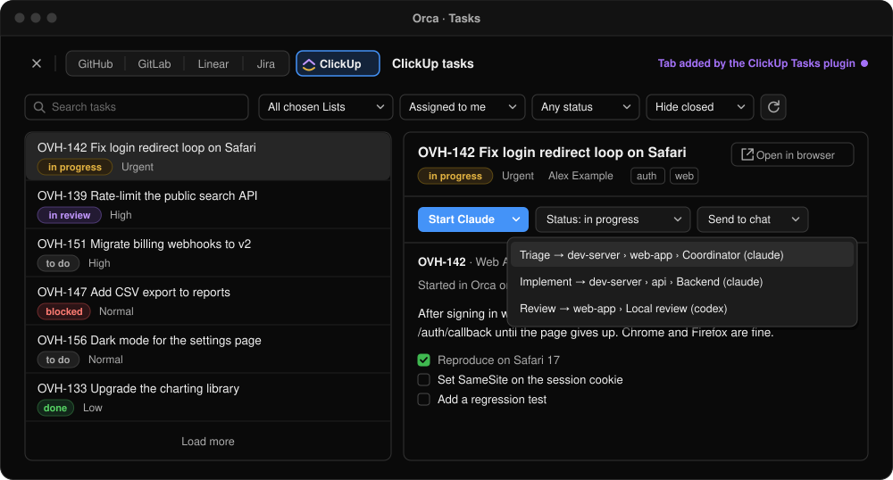
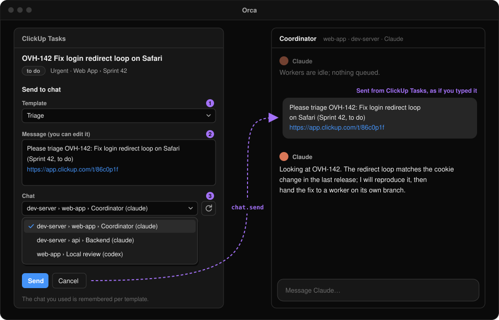
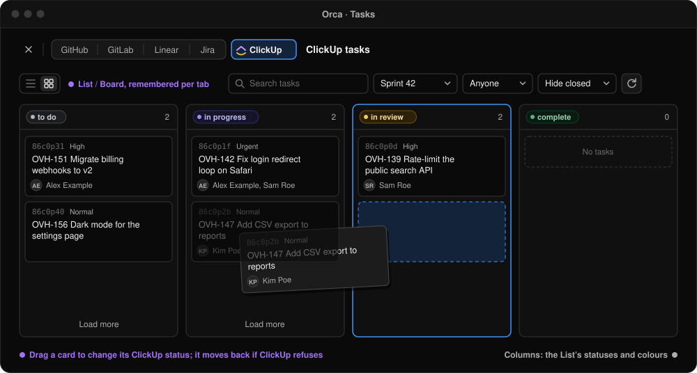

# ClickUp Tasks for Orca (Overhedge fork)

Your ClickUp tasks, from the Lists you choose, in Orca's right sidebar and (with the Overhedge Orca
build) as a ClickUp tab on Orca's Tasks page. Sign in with OAuth, start a task in its own worktree
with your coding agent, and let the task's status follow the List's own workflow.

Fork of [gthjnk/orca-clickup-tasks](https://github.com/gthjnk/orca-clickup-tasks) (MIT), based on its
`feature/start-task` branch after a full audit: see [SECURITY-AUDIT.md](SECURITY-AUDIT.md).

<p align="center">
  
  <br /><sub>The ClickUp tab on Orca's Tasks page. All mockups use placeholder data.</sub>
</p>

<p align="center">
  
  <br /><sub>Send to chat: template, editable message, an open chat, Send.</sub>
</p>

> [!NOTE]
> The Tasks page tab and Send to chat need the
> [Overhedge build of Orca](https://github.com/ferbiy/orca-overhedge) (plugin task sources and
> plugin chat send). On stock Orca use 0.3.0, which has the sidebar panel only.

## What it does

- **Sign in with ClickUp (OAuth)**, using your own ClickUp OAuth app. A personal API token still works
  as a fallback.
- **Choose which Spaces, Folders or Lists Orca may see** (Settings › Lists). Only tasks in those Lists
  are fetched, shown, or ever put into an agent prompt. Nothing is fetched until you choose.
- **My tasks** (assigned to you, in the chosen Lists) and **Browse** (the chosen Lists only), with
  search, filters and the full task view and editing from the upstream plugin.
- **Start in worktree**: Orca creates a worktree and branch named after the task (the Custom Task ID
  when the Workspace uses them, e.g. `OVH-142-fix-login`, else `CU-<id>-<title>`) on this computer or
  on a paired Orca server, and starts your agent there with the task as its first prompt.
- **Status follows the List**: on start the task moves to the List's in-progress status. Moving it to
  the List's review status when the agent first finishes is a setting, **off by default** since 0.3.0
  (agents set their own review status); turn it on in Settings if you want it. Defaults come from
  ClickUp's status types; each List can override them or say "don't change". When no status fits,
  nothing changes and the run card says why. A comment with the branch and agent is posted on start
  (and on finish when that move is on); it can be turned off.
- **Send to chat** (Overhedge Orca build with chat send): instead of a new worktree, send a short
  prepared message with the task link into an Orca chat that is already open (on this computer or
  the paired server) and let that chat take it from there. See [Send to chat](#send-to-chat-overhedge-build).
- **Tasks page tab** (Overhedge Orca build only): the same tasks, search, filters, status menu and
  Start, on Orca's own Tasks page, as a list or (0.5.0+) a Kanban board by status. See [Orca's Tasks page](#orcas-tasks-page-overhedge-build).
- **Status colours** (0.4.1): every status shows its ClickUp colour: group titles, the status badge,
  the status menus, subtasks, the Start form, the run card, and on the Tasks page the status pill,
  Status menu and Status filter. On the Overhedge Orca build (0.4.2+ of the plugin) the status badge,
  subtasks, the run card and the whole Tasks page draw the real colour (a tinted badge with a dot);
  elsewhere, and in group titles and menus, the panel shows the nearest coloured circle before the
  name (🔵 in progress, 🟣 review, ⚪ to do). A status without a usable colour gets one from a fixed
  palette, picked by a hash of its name, so it is the same everywhere and never changes. See
  [Status colours](#status-colours).

## Install (Orca desktop app)

Install only a pinned commit of this fork, never the community catalog listing:

```sh
orca plugin install https://github.com/ferbiy/orca-clickup-tasks@<commit-sha> --json
# exits with approval_required and prints a fingerprint; review the permissions below, then:
orca plugin install https://github.com/ferbiy/orca-clickup-tasks@<commit-sha> --approve <fingerprint> --json
```

The plugin installs as `ferbiy.clickup-tasks`. A commit-pinned install never updates by itself:
`orca plugin update` reports it as `pinned`, and Orca's automatic updater only touches catalog
installs. To move to a newer version, install the newer commit the same way. We also recommend
turning off **Settings › Plugins › Update plugins automatically** (`pluginUpdatePolicy: "manual"`)
so no catalog plugin updates silently. A plugin cannot change that setting itself.

**From 0.2.0:** "Move to review when the agent first finishes" is now off by default. 0.2.0 saved
every setting whenever any one changed, so a saved "on" that was only the old default reads as off
after the update; an explicit "off" stays off. Turn it on again in Settings if you want it.

If the upstream `gthjnk.clickup-tasks` is installed, uninstall it first (`orca plugin uninstall
gthjnk.clickup-tasks`) so there is one ClickUp panel.

**Where it runs.** Plugins run in the Orca desktop app (the worker is a process of the desktop's main
process). With the desktop paired to a remote Orca server, the worker, the browser and the OAuth
loopback listener are all on your computer, and a project on the server is started on the server.
A headless `orca serve` has no plugin service, so this plugin cannot run there, and Orca's web
client in a browser cannot use it.

Requires Orca `>=1.4.273` (0.4.0 asks for `chat:send`, which only the Overhedge build knows: stock
Orca refuses to install it; stay on 0.3.0 there) and an OS keychain (macOS Keychain; on Linux GNOME Keyring or KWallet).

## Connect: create your ClickUp OAuth app (once)

ClickUp has no PKCE and no public clients, so the token exchange needs the app's client secret. The
app is yours; its secret is stored only in your OS keychain through Orca, never in this repository
or in any file.

1. In ClickUp (Workspace owner or admin): avatar (top right) › **Settings** › **Apps** ›
   **Create new app**.
2. **App name**: `Orca (Overhedge)`.
3. **Redirect URL**: `http://127.0.0.1:47386/callback` (ClickUp may show only the host part,
   `127.0.0.1`; that is fine). If ClickUp refuses `127.0.0.1`, use `http://localhost:47386/callback`
   and enter the same URL in the plugin.
4. Copy the **Client ID** and **Client secret**.
5. In Orca, open the **ClickUp Tasks** panel, paste the client id, the secret and (only if you
   changed it) the redirect URL, and press **Save app**.
6. Press **Sign in with ClickUp**, then **Open ClickUp to allow access**. Pick the Workspace(s) and
   allow. The browser comes back to `127.0.0.1:47386`, the panel signs in by itself, and the tab says
   you can close it.
7. Open **Settings › Lists** and choose what Orca may see.

If the browser cannot reach the listener (port 47386 in use, or a non-loopback redirect URL), copy the
address the browser ended on (it may show an error page) into **Address your browser ended on** and
press **Finish sign-in**.

**Sign out** deletes the token from Orca; the app stays saved for the next sign-in (**Forget app**
removes it). ClickUp has no API to revoke a token: to cut access everywhere, regenerate the app's
secret or delete the app in ClickUp › Settings › Apps. OAuth tokens do not expire today; if ClickUp
refuses the token later, the panel returns to the sign-in screen.

Fallback: **Use a personal API token instead** (ClickUp › Settings › Apps › API Token). It acts as
you in every Workspace and never expires; use it for development only.

## Permissions

| Capability | Why |
|---|---|
| `secrets:own` | Keep the ClickUp token and the OAuth app's client secret in the OS keychain. |
| `storage:own` | Cache tasks, statuses and the Workspace hierarchy; remember the chosen Lists, status choices, settings and task ↔ worktree links. |
| `workspace:read` | List your projects (all hosts) for the Start form, read back the branch Orca created, and drop a link when its worktree is removed. |
| `workspace:create` | Create one worktree per task you start, on the project's host. |
| `agent:launch` | Start your agent in that worktree with the task prompt (part of `workspace.create`). |
| `agent:read` | Know when the agent is working, needs input or has finished (status move, notification), and check runs that never started. |
| `notifications:show` | "Claude finished …" / "needs input" notifications. |
| `chat:send` | Send to chat (Overhedge build only): list your open Orca chats (agent, chat and workspace names, never their messages) and send the message you confirmed into the one you pick. |

Not requested (the upstream branch asked for them): `terminal:read`, `terminal:send`,
`workspace:write`. The plugin never reads or types into a terminal and never switches your focus.
It has no hooks and no settings capability. Only its worker talks to the network: to
`api.clickup.com`, plus a listener on `127.0.0.1:47386` while a sign-in waits.

## Privacy and safety

- Only the chosen Lists are queried (`list_ids[]`), and any task outside them is refused before it
  is cached, shown or put into a prompt.
- Task text is untrusted. In the agent prompt only the task id and its ClickUp link sit outside a
  random per-prompt fence; the title, description, checklists, fields, attachments and comments are
  inside it, marked as data, not instructions. Task text still goes to your model provider with the
  prompt, as for Jira or Linear in Orca.
- ClickUp changes only through what you start or edit (in the panel or on the Tasks page): a status
  move and comment at start, and (setting, off by default) a status move and comment the first time
  the agent finishes, only while the task still shows the status the start set.
- Send to chat puts into a chat only the message you saw (panel) or the template as written (Tasks
  page menu): task text in it is cleaned, the description only on request and fenced as data. It
  goes into a chat that is open now on this computer or the paired server, never a new chat or a
  terminal. It is the message you would have typed yourself, so the agent in that chat acts on it
  as on any message of yours.
- ClickUp allows 100 requests a minute per token on Free, Unlimited and Business plans. The worker
  keeps itself under 80 a minute for the panel and the Tasks page together, caches lists, statuses
  and the hierarchy, and stops after a 429 until ClickUp's reset time. The plugin itself polls
  nothing; the Tasks page asks for its list every two minutes while it is open (see below).

## Send to chat (Overhedge build)

For a team that works in chats it already has open: from a task, send a short prepared message with
the task link into one of those chats. No worktree, no agent start, no run card: the chat owns it.
Needs the Overhedge Orca build with plugin chat send (fork branch `overhedge/chat-send`;
`OVERHEDGE.md` › "Plugin chat send"); on any other Orca the button says so and nothing is sent.

**Add templates (once).** Settings › **Send to chat** › **Add template**: a name ("Triage",
"Implement") and a short message with placeholders, for example

```text
Please triage {task_id}: {title} ({list}, {status})
{task_url}
```

Placeholders: `{task_url}` (the ClickUp link), `{task_id}` (the Custom Task ID such as `OVH-142` when
the Workspace uses them, else the task id), `{title}`, `{list}`, `{status}`, `{assignees}`, and
`{description}`. Title, List, status and assignees are cleaned (control, bidi and invisible
characters removed, one line, capped). The description is left out unless the template has
`{description}`; then it goes in a block between random fence lines, marked as data from ClickUp,
not instructions (at most 1500 characters). A template cannot start with `/` (the chat would run it
as a command). Optional per template, both **off** by default: a **default chat**, **comment on the
task** after sending, and **move the task to a status** (by name, if its List has it).

**Send from the panel.** Open a task › **Send to chat ▾** › pick the template › the message is
filled in and you can edit it › pick the chat (your open Orca chats on this computer and on the
paired server, shown as `server › workspace › chat (agent)`; terminal agents are not listed) ›
**Send**. A busy chat queues the message and takes it after its current turn. The chat you used is
remembered per template and preselected next time.

**Send from the Tasks page.** The task's **Send to chat ▾** menu lists the templates with the chat
each goes to (the last one used, else the template's default) and sends the filled message as is.
The Tasks page has no editor or chat picker, so a template with no chat yet asks you to send it once
from the panel (or set its default chat).

The plugin cannot read the chats, open new ones or type into terminals: Orca's `chat.send` takes only
an open chat's id and plain text, and the panel's preview is the confirmation (no further prompt).

## Orca's Tasks page (Overhedge build)

Needs the Overhedge Orca build that contains plugin task sources (fork branch
`overhedge/task-sources`, from 97de206 on; `OVERHEDGE.md` › "Plugin task sources"). The plugin
declares three worker commands, `taskSource.clickup.list`, `.get` and `.action`; that build turns
them into a **ClickUp** tab on the Tasks page next to GitHub, GitLab, Linear and Jira. On stock Orca
they are ordinary command palette entries ("ClickUp tasks", "ClickUp tasks: task details / task
action (used by the Tasks page)"): running one from the palette sends no ClickUp request and does
nothing useful, and the panel works as before. No new permission is needed.

- **List or Board**: on an Orca build with the plugin task board (fork branch
  `overhedge/task-board`; `OVERHEDGE.md` › "Plugin task board") the tab has a **List / Board**
  switch, remembered per tab. See [Board](#board-overhedge-build).
- **List**: only tasks of the Lists chosen in Settings › Lists (nothing before you choose; a notice
  says so, or asks you to sign in in the panel first). Filters: **List** (all chosen Lists or one,
  shown as `Folder › List`), **Assignee** (me, the default, or anyone), **Status** (the chosen
  List's real statuses; with all Lists, the statuses already cached), **Closed** (hidden by
  default). Search matches the title, Custom Task ID, task id and List name. **Load more** pages on.
- **Detail**: title with the Custom Task ID, status, priority, assignees, tags, and a body with the
  location, due date, the description (ClickUp's markdown, untrusted: shown through Orca's sanitizing
  markdown view, as in the panel), checklists, subtasks and the Orca runs started for the task.
- **Actions**: **Send to chat ▾** (see [Send to chat](#send-to-chat-overhedge-build); only with
  templates and an Orca that has chat send), **Status ▾** (the List's statuses; moves the task and refreshes the panel's row),
  **Start <agent> ▾** (your git projects on every host, the one last used for that List first). Start
  is the panel's Start flow with your Settings defaults (agent, base branch, move to in progress,
  task context): a worktree and branch named after the Custom Task ID as the team writes it
  (`OVH-142-<slug>`, else `CU-<id>-<slug>`), the agent with the fenced task prompt, the status move
  and comment; the run then shows on the panel's card as usual. **Open in browser** is the Tasks
  page's own button for the task's ClickUp link.
- **Requests**: "mine, not closed" views (the default) come from the panel's My tasks cache, fetched
  again only when older than a minute; other views ask ClickUp for one page of 100 at a time and
  reuse it for a minute (ClickUp has no text search, so a search there reads up to five pages per
  answer). The page asks again every two minutes while open, so an open Tasks page costs about one
  My tasks fetch (one request per 100 tasks per 40 Lists) every two minutes. Opening a task costs one
  request; a status move two.

## Board (Overhedge build)

<p align="center">
  
  <br /><sub>Board view (placeholder data).</sub>
</p>

Needs plugin 0.5.0+ and an Overhedge Orca build with the plugin task board. The plugin sees the
build's `features: ["board"]` and adds the status columns to its list answer; other builds keep the
list only. The board shows the same tasks as the list, with the same filters and search.

- **Columns** are statuses in the List's workflow order, coloured like ClickUp's, every status of
  the List even when empty (so you can drop on it), closed ones last. With **All chosen Lists**,
  statuses of different Lists are merged by name (any case) into one column, as ClickUp's own board
  does over a Space or Folder: ClickUp's groups (open, not started, active, done, closed) in that
  order, then each status's earliest position; the first List's spelling and colour win. A
  status's own List decides whether a task can move there: dropping a task on a column its List
  doesn't have is refused (ClickUp's message) and the card goes back.
- **Cards** show the task id, title (with the Custom Task ID), priority and assignees. A click opens
  the same detail (actions, Status, Start, Send to chat) beside the board.
- **Moving**: drag a card to another column, or use the card's Move menu. The card moves at once;
  the plugin runs the detail's Status action (same checks: only a status of the task's List), and
  if ClickUp refuses, the card goes back with the reason.
- **Requests**: the board is the list's answer, so it costs the same as the list. With All chosen
  Lists, the plugin also reads the statuses of up to five Lists per answer whose tasks are on screen
  and whose statuses are not cached yet (cached for an hour). **Load more** at the bottom of a
  column asks for more of that status only (one page, one request, or none from the My tasks
  cache). A closed column stays empty while closed tasks are hidden; it is there to drop on.

## Status colours

ClickUp gives every status a colour (`#rrggbb`) on tasks and in a List's statuses. The plugin keeps a
colour only when it is exactly `#rgb` or `#rrggbb` and never writes it into CSS or HTML itself.
Anything else, or no colour, gives the status a colour from a fixed palette of twelve, chosen by a
hash of the status name: stable across sessions and machines, so nothing needs storing. Every
palette colour keeps 3:1 contrast on Orca's light and dark backgrounds.

- **Sidebar**: where Orca draws Badge colours (`ui.has('Badge', 'color')`, the Overhedge build), the
  task's status badge, each subtask's status and the run card's status moves are Badges in the
  status's own colour with the plain name. Group titles, status menus and the Start checkbox are
  plain text in Orca's kit (no colour there), so they keep the nearest of 🔴🟠🟡🟢🔵🟣🟤⚫⚪ before
  the name, as does everything on stock Orca, which has no colour prop. Colour emoji look the same
  in light and dark themes, and the name stays as text, so nothing gets harder to read.
- **Tasks page**: each item, Status menu option and Status filter option carries `color` (the checked
  hex), and board columns carry it too. The Overhedge build sends `features: ["status-color"]` with its commands and draws `color`
  itself (a tinted status pill and coloured dots), so the plugin sends plain labels. A build without
  that feature gets the circle in the label instead.

## Limitations

- The Tasks page tab needs the Overhedge Orca build (above); stock Orca has no plugin task-source
  extension point yet (upstream PR #26282 is open).
- If Orca loses the agent's first prompt, the run card shows it for you to paste; the plugin no longer
  retries by typing into the terminal.
- Not included: creating top-level tasks, time tracking, several accounts at once. The Tasks page
  has no comments, editing or per-start choices (agent, base branch): use the panel for those.

## Development

No build step and no npm dependencies. Tests use Orca's own runner:

```sh
orca plugin test .
orca plugin types . && npx -y -p typescript@5.9.3 tsc -p . --noEmit
orca plugin check . --json
orca plugin dev watch .
```

Design: [docs/ARCHITECTURE.md](docs/ARCHITECTURE.md) (upstream design; see "Overhedge fork changes"
at its top). Task context: [docs/TASK-CONTEXT.md](docs/TASK-CONTEXT.md).

## License

MIT (upstream copyright kept in [LICENSE](LICENSE)).
